<div align="center">
  
</div>

<div align="center">
  <a href="https://nextjs.org/"></a>
  <a href="https://react.dev/"></a>
  <a href="https://www.typescriptlang.org/"></a>
  <a href="https://tailwindcss.com/"></a>
  <a href="https://github.com/chacaejosue/odontoclinic-app/commits/main/"></a>
</div>

<h1 align="center">Odontoclinic</h1>

<p align="center">
  Sitio web institucional para una clínica odontológica en Camiri, Bolivia, diseñado para comunicar confianza, servicios y facilitar la solicitud de citas.
</p>

## Descripción

Odontoclinic es una landing page moderna y responsive para la clínica de la Dra. Pamela Claros. La experiencia está enfocada en presentar la propuesta de valor de la clínica, mostrar sus instalaciones y tratamientos, responder preguntas frecuentes y conectar a los pacientes con el proceso de agendamiento.

La interfaz utiliza una identidad visual teal, componentes accesibles, imágenes optimizadas y una navegación pensada para dispositivos móviles y escritorio.

## Características principales

- Hero responsive con llamada a la acción para solicitar una cita.
- Catálogo de servicios odontológicos.
- Perfil de la doctora y pilares de confianza.
- Galería responsive de las instalaciones.
- Ubicación, horarios y datos de contacto.
- Preguntas frecuentes.
- Flujo de agendamiento conectado con WhatsApp.
- Gestión de imágenes por slots con almacenamiento local o Cloudinary.
- Google Reviews con respuesta alternativa cuando no existe configuración externa.
- Optimización responsive con `next/image` y WebP.
- Protección de endpoints administrativos y cabeceras de seguridad.

## Stack tecnológico

| Área | Tecnología |
| --- | --- |
| Framework | Next.js 16 con App Router |
| UI | React 19 |
| Lenguaje | TypeScript 5 |
| Estilos | Tailwind CSS 4 |
| Iconos | Lucide React |
| Imágenes | `next/image`, WebP y Cloudinary opcional |
| Despliegue | Compatible con Vercel y Node.js |

## Requisitos

- Node.js 20 o superior.
- npm 10 o superior.
- Variables de entorno opcionales para reseñas, autenticación administrativa y Cloudinary.

## Instalación

Clona el repositorio e instala las dependencias:

```bash
git clone https://github.com/chacaejosue/odontoclinic-app.git
cd odontoclinic-app
npm install
```

Inicia el entorno de desarrollo:

```bash
npm run dev
```

Abre [http://localhost:3000](http://localhost:3000).

## Scripts disponibles

```bash
npm run dev       # Inicia el servidor de desarrollo
npm run build     # Genera la compilación de producción
npm run start     # Inicia la aplicación compilada
npm run lint      # Ejecuta ESLint
```

## Variables de entorno

El proyecto puede funcionar en modo local sin configurar servicios externos. Para habilitar integraciones adicionales, crea un archivo `.env.local`:

```env
# Reseñas de Google Places
GOOGLE_PLACES_API_KEY=
GOOGLE_PLACE_ID=

# Protección del endpoint de administración de imágenes
ADMIN_IMAGE_API_KEY=
ADMIN_SESSION_SECRET=

# Almacenamiento opcional en Cloudinary
CLOUDINARY_CLOUD_NAME=
CLOUDINARY_API_KEY=
CLOUDINARY_API_SECRET=
```

Cuando las credenciales de Cloudinary no están presentes, las imágenes administrables se guardan en `public/images/uploads` y sus referencias se gestionan mediante el manifiesto local.

## Estructura del proyecto

```text
src/
├── app/              # Rutas, layout, metadata y endpoints API
├── components/       # Componentes de la interfaz
├── config/           # Navegación, servicios y slots de imágenes
├── data/              # Manifiestos locales de contenido
├── lib/               # Servicios, hooks y autenticación
└── types/             # Tipos de dominio
public/
├── images/            # Imágenes optimizadas y recursos visuales
└── odontoclinic-cover-v3.svg
```

## Calidad y verificación

Antes de abrir un Pull Request, ejecuta:

```bash
npm run lint
npm run build
```

La compilación de producción valida TypeScript, las rutas del App Router y la generación estática de las páginas.

## Licencia

Este proyecto es privado y pertenece a Odontoclinic. Su código, identidad visual, textos e imágenes no deben reutilizarse sin autorización.

## Contacto

Odontoclinic — Camiri, Bolivia

Para solicitar una cita, utiliza el botón de agendamiento disponible en la página web.
